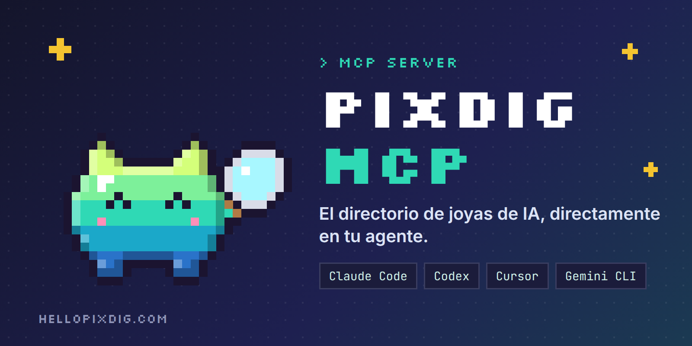
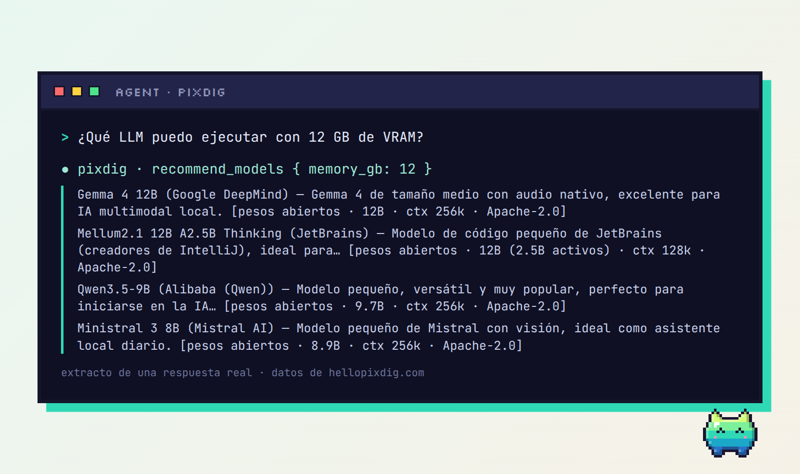
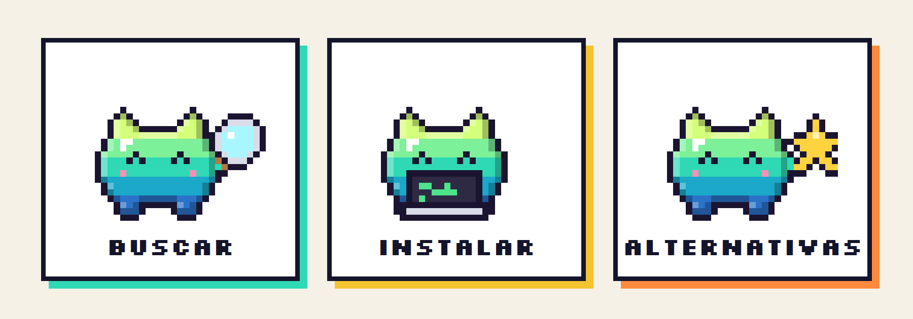
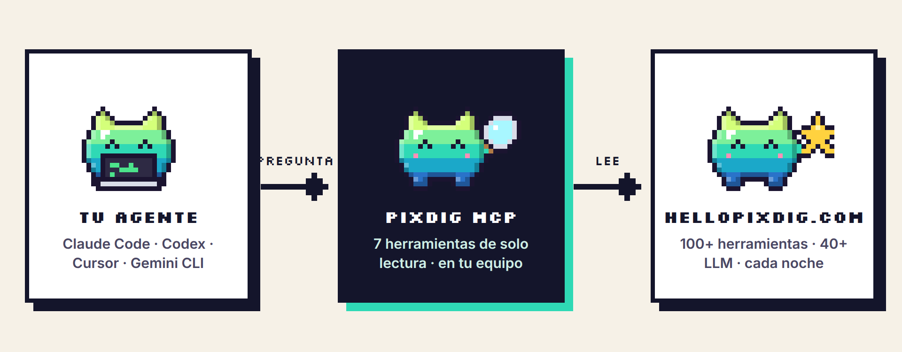

<p align="center">
  
</p>

<p align="center">
<a href="LICENSE"></a>   <a href="https://hellopixdig.com/es/"></a>
</p>

<p align="center"><a href="README.md">English</a> · <a href="README.fr.md">Français</a> · <b>Español</b></p>

# PixDig MCP

> El directorio de joyas de IA, directamente en su agente.

**PixDig MCP** conecta su agente de código con el directorio [PixDig](https://hellopixdig.com/es/): más de 150 herramientas de IA verificadas (estrellas reales de GitHub, licencia, precio, compatibilidad, equipo necesario), más de 40 LLM y un catálogo seleccionado de unos 1000 repositorios de GitHub, con un prompt de instalación listo para seguir en cada herramienta. Solo lectura, sin cuenta, sin clave de API.

## Véalo en acción

<p align="center"></p>
<p align="center"><sub>Extracto de una respuesta real del servidor (datos de hellopixdig.com).</sub></p>

## Qué puede pedirle a su agente

- «¿Qué herramientas gratuitas editan vídeo en local?»
- «Encuentra una herramienta de transcripción compatible con Ollama.»
- «Instálame ComfyUI.» → el agente obtiene la ficha, le muestra los comandos oficiales y el prompt de instalación, y pide su permiso antes de ejecutar nada.
- «¿Qué LLM puedo ejecutar con 12 GB de VRAM?»
- «Encuéntrame una alternativa gratuita a ElevenLabs.»
- «¿Qué joyas están destacadas ahora mismo?»

<p align="center"></p>

## Instalación

Requiere **Node.js 18 o posterior** (y `git` para la forma GitHub).

**Claude Code**

```bash
claude mcp add pixdig -- npx -y github:hellopixdig/pixdig-mcp
```

**Codex (`~/.codex/config.toml`)**

```toml
[mcp_servers.pixdig]
command = "npx"
args = ["-y", "github:hellopixdig/pixdig-mcp"]
```

**Cursor (`~/.cursor/mcp.json`) · Gemini CLI (`~/.gemini/settings.json`)**

```json
{
  "mcpServers": {
    "pixdig": { "command": "npx", "args": ["-y", "github:hellopixdig/pixdig-mcp"] }
  }
}
```

¿Sin git? El mismo paquete lo sirve también el sitio de PixDig (sin cuenta npm):

```bash
claude mcp add pixdig -- npx -y https://hellopixdig.com/pixdig-mcp.tgz
```

¿Prefiere comprobarlo antes? Todo el servidor cabe en un único archivo legible, [`src/index.js`](src/index.js) (unas 270 líneas, dos dependencias).

## Cómo funciona

<p align="center"></p>

Su agente llama al servidor MCP local por stdio. El servidor solo lee archivos JSON públicos publicados por el sitio de PixDig, actualizados cada noche.

## Las 9 herramientas

| Herramienta | Qué hace |
|---|---|
| `search_tools` | Busca por palabras clave, uso, compatibilidad (Claude Code, Ollama, MCP…), gratis, local, open source. Orden por estrellas o por fecha. |
| `get_tool` | Ficha completa de una herramienta: qué hace, equipo recomendado, requisitos, comandos oficiales y prompt de instalación listo para pegar. |
| `list_usecases` | Los usos del directorio (vídeo, imagen, audio, agentes, memoria…) con el número de herramientas. |
| `recommend_models` | LLM según el uso y el tipo (de pago / pesos abiertos). Con `memory_gb`, solo los modelos abiertos que caben en esa memoria en 4 bits. |
| `get_model` | Detalles de un modelo: licencia, parámetros, contexto, acceso, equipo necesario, enlaces oficiales. |
| `find_alternative` | Alternativas gratuitas o de código abierto a un servicio de pago (ChatGPT Plus, Midjourney, ElevenLabs, Zapier, Notion, Cursor…). Sin argumento, lista todos los servicios cubiertos. |
| `featured` | Las joyas destacadas en este momento. |
| `search_catalog` | Busca en el catálogo seleccionado de unos 1000 repositorios de GitHub (skills, servidores MCP, agentes, LLM, voz, medios, herramientas), ordenados por estrellas y frescura. Filtro por `theme`. |
| `get_ranking` | Ranking de las herramientas por estrellas de GitHub: 24 h (`day`), 7 días (`week`) o todos los tiempos (`all`). |

Cada herramienta acepta `lang: "fr" | "en" | "es"`.

## Confianza y transparencia

- **Solo lectura.** Las siete herramientas están declaradas de solo lectura. El servidor no ejecuta ningún comando ni escribe ningún archivo.
- **Un único tipo de llamada de red.** Simples peticiones HTTPS `GET` de JSON público en `hellopixdig.com/data/api` (o una carpeta local, véase más abajo). Solo se envía la cabecera `User-Agent`: `pixdig-mcp/<versión>`.
- **Sin telemetría, sin analíticas, sin cuenta, sin clave de API.**
- **El contenido patrocinado se señala.** Las promociones de pago aparecen marcadas `COLABORACIÓN / SPONSORED` en las respuestas, y el servidor pide al agente que lo diga. PixDig vende visibilidad, nunca una opinión.
- **Su agente pregunta primero.** El servidor le indica que muestre los comandos de instalación y obtenga su permiso antes de ejecutarlos.
- **Superficie reducida.** Un archivo, dos dependencias ([`@modelcontextprotocol/sdk`](https://github.com/modelcontextprotocol/typescript-sdk) y [`zod`](https://github.com/colinhacks/zod)). Los datos se guardan en memoria durante una hora.

## Configuración

| Variable | Valor por defecto | Función |
|---|---|---|
| `PIXDIG_DATA` | `https://hellopixdig.com/data/api` | Otra fuente: una URL o una carpeta local con `tools.fr.json`, `tools.en.json`, `tools.es.json`, `models.json`, `meta.json`, `alternatives.json`. |

## Desarrollo

```bash
git clone https://github.com/hellopixdig/pixdig-mcp.git
cd pixdig-mcp
npm install
npm test
```

`npm test` arranca el servidor por stdio y llama a cada herramienta (lee los datos en línea salvo que se defina `PIXDIG_DATA`).

## Proponer una herramienta

¿Ha creado una herramienta de IA? [Envíe su dossier](https://hellopixdig.com/es/partner): inclusión gratuita o promoción de pago, y respondemos a cada solicitud. Una inclusión nunca es automática ni está garantizada.

## Más información

[Contribuir](CONTRIBUTING.md) · [Política de seguridad](SECURITY.md) · [Registro de cambios](CHANGELOG.md)

---

Publicado bajo la [licencia MIT](LICENSE). Hecho por [PixDig](https://hellopixdig.com/es/), una vigilancia de IA llevada desde Limoges, Francia.
