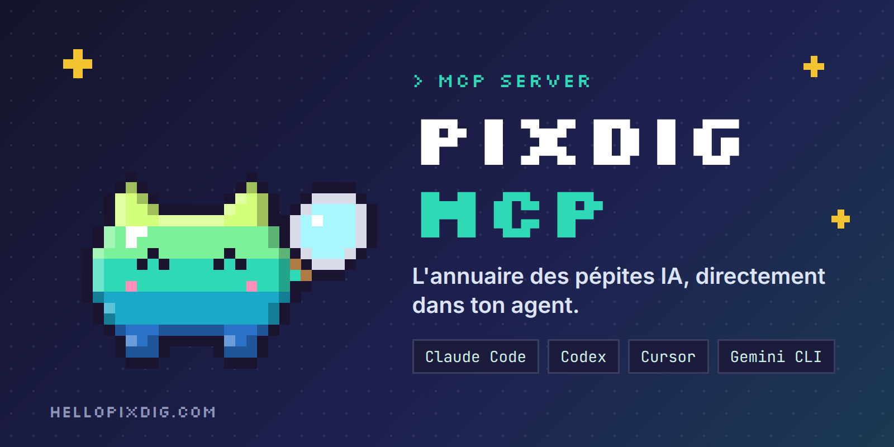
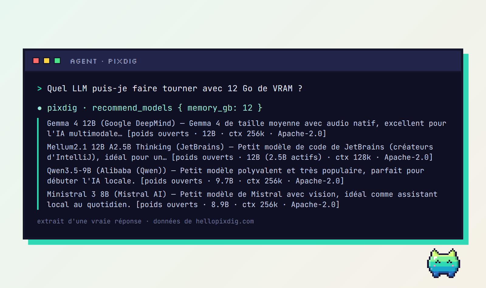
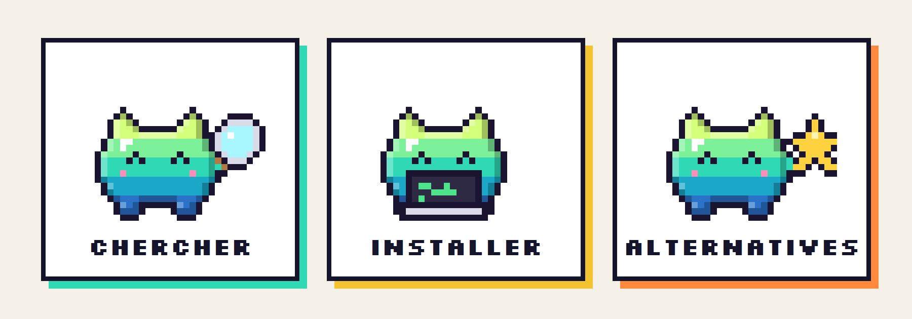
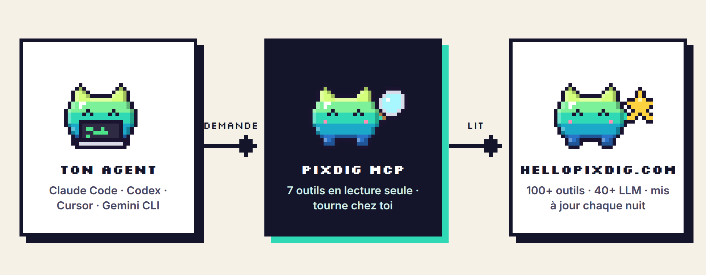

<p align="center">
  
</p>

<p align="center">
<a href="LICENSE"></a>   <a href="https://hellopixdig.com/fr/"></a>
</p>

<p align="center"><a href="README.md">English</a> · <b>Français</b> · <a href="README.es.md">Español</a></p>

# PixDig MCP

> L'annuaire des pépites IA, directement dans votre agent.

**PixDig MCP** relie votre agent de code à l'annuaire [PixDig](https://hellopixdig.com/fr/) : plus de 150 outils d'IA vérifiés (étoiles GitHub réelles, licence, prix, compatibilité, machine nécessaire), plus de 40 LLM et un catalogue sélectionné d'environ 1 000 dépôts GitHub, avec pour chaque outil un prompt d'installation prêt à suivre. Lecture seule, sans compte, sans clé d'API.

## Voir le résultat

<p align="center"></p>
<p align="center"><sub>Extrait d'une vraie réponse du serveur (données de hellopixdig.com).</sub></p>

## Ce que vous pouvez demander à votre agent

- « Quels outils gratuits pour monter des vidéos en local ? »
- « Trouve un outil de transcription compatible avec Ollama. »
- « Installe-moi ComfyUI. » → l'agent récupère la fiche, vous montre les commandes officielles et le prompt d'installation, et demande votre accord avant d'exécuter quoi que ce soit.
- « Quel LLM puis-je faire tourner avec 12 Go de VRAM ? »
- « Trouve-moi une alternative gratuite à ElevenLabs. »
- « Quelles pépites sont à la une en ce moment ? »

<p align="center"></p>

## Installation

Nécessite **Node.js 18 ou plus** (et `git` pour la forme GitHub).

**Claude Code**

```bash
claude mcp add pixdig -- npx -y github:hellopixdig/pixdig-mcp
```

**Codex (`~/.codex/config.toml`)**

```toml
[mcp_servers.pixdig]
command = "npx"
args = ["-y", "github:hellopixdig/pixdig-mcp"]
```

**Cursor (`~/.cursor/mcp.json`) · Gemini CLI (`~/.gemini/settings.json`)**

```json
{
  "mcpServers": {
    "pixdig": { "command": "npx", "args": ["-y", "github:hellopixdig/pixdig-mcp"] }
  }
}
```

Pas de git ? Le même paquet est aussi servi par le site PixDig (sans compte npm) :

```bash
claude mcp add pixdig -- npx -y https://hellopixdig.com/pixdig-mcp.tgz
```

Vous préférez vérifier avant ? Tout le serveur tient dans un seul fichier lisible, [`src/index.js`](src/index.js) (environ 270 lignes, deux dépendances).

## Comment ça marche

<p align="center"></p>

Votre agent appelle le serveur MCP local via stdio. Le serveur ne fait que lire des fichiers JSON publics publiés par le site PixDig, mis à jour chaque nuit.

## Les 9 outils

| Outil | Rôle |
|---|---|
| `search_tools` | Recherche par mots-clés, usage, compatibilité (Claude Code, Ollama, MCP…), gratuit, local, open source. Tri par étoiles ou par date. |
| `get_tool` | Fiche complète d'un outil : ce qu'il fait, machine conseillée, prérequis, commandes officielles et prompt d'installation prêt à coller. |
| `list_usecases` | Les usages de l'annuaire (vidéo, image, audio, agents, mémoire…) avec le nombre d'outils. |
| `recommend_models` | LLM selon l'usage et le type (payant / poids ouverts). Avec `memory_gb`, seuls les modèles ouverts qui tiennent dans cette mémoire en 4 bits. |
| `get_model` | Détails d'un modèle : licence, paramètres, contexte, accès, machine requise, liens officiels. |
| `find_alternative` | Alternatives gratuites ou open source à un service payant (ChatGPT Plus, Midjourney, ElevenLabs, Zapier, Notion, Cursor…). Sans argument, liste tous les services couverts. |
| `featured` | Les pépites actuellement à la une. |
| `search_catalog` | Cherche dans le catalogue sélectionné d'environ 1 000 dépôts GitHub (skills, serveurs MCP, agents, LLM, voix, média, outils), classés par étoiles et fraîcheur. Filtre par `theme`. |
| `get_ranking` | Classement des outils par étoiles GitHub : 24 h (`day`), 7 jours (`week`) ou tout temps (`all`). |

Chaque outil accepte `lang: "fr" | "en" | "es"`.

## Confiance et transparence

- **Lecture seule.** Les sept outils sont déclarés en lecture seule. Le serveur n'exécute aucune commande et n'écrit aucun fichier.
- **Un seul type d'appel réseau.** De simples requêtes HTTPS `GET` de JSON public sur `hellopixdig.com/data/api` (ou un dossier local, voir plus bas). Seul l'en-tête `User-Agent` est envoyé : `pixdig-mcp/<version>`.
- **Aucune télémétrie, aucune statistique, aucun compte, aucune clé d'API.**
- **Les contenus sponsorisés sont signalés.** Les mises en avant payantes sont marquées `PARTENARIAT / SPONSORED` dans les réponses, et le serveur demande à l'agent de le dire. PixDig vend de la visibilité, jamais un avis.
- **Votre agent demande d'abord.** Le serveur lui demande de montrer les commandes d'installation et d'obtenir votre accord avant de les lancer.
- **Surface réduite.** Un fichier, deux dépendances ([`@modelcontextprotocol/sdk`](https://github.com/modelcontextprotocol/typescript-sdk) et [`zod`](https://github.com/colinhacks/zod)). Les données sont mises en cache en mémoire pendant une heure.

## Configuration

| Variable | Défaut | Rôle |
|---|---|---|
| `PIXDIG_DATA` | `https://hellopixdig.com/data/api` | Autre source : une URL, ou un dossier local contenant `tools.fr.json`, `tools.en.json`, `tools.es.json`, `models.json`, `meta.json`, `alternatives.json`. |

## Développement

```bash
git clone https://github.com/hellopixdig/pixdig-mcp.git
cd pixdig-mcp
npm install
npm test
```

`npm test` lance le serveur en stdio et appelle chaque outil (il lit les données en ligne, sauf si `PIXDIG_DATA` est défini).

## Proposer un outil

Vous avez créé un outil d'IA ? [Déposez votre dossier](https://hellopixdig.com/fr/partner) : inscription gratuite ou mise en avant payante, et nous répondons à chaque candidature. Une inscription n'est jamais automatique ni garantie.

## Aller plus loin

[Contribuer](CONTRIBUTING.md) · [Politique de sécurité](SECURITY.md) · [Journal des modifications](CHANGELOG.md)

---

Publié sous [licence MIT](LICENSE). Réalisé par [PixDig](https://hellopixdig.com/fr/), une veille IA menée depuis Limoges, en France.
