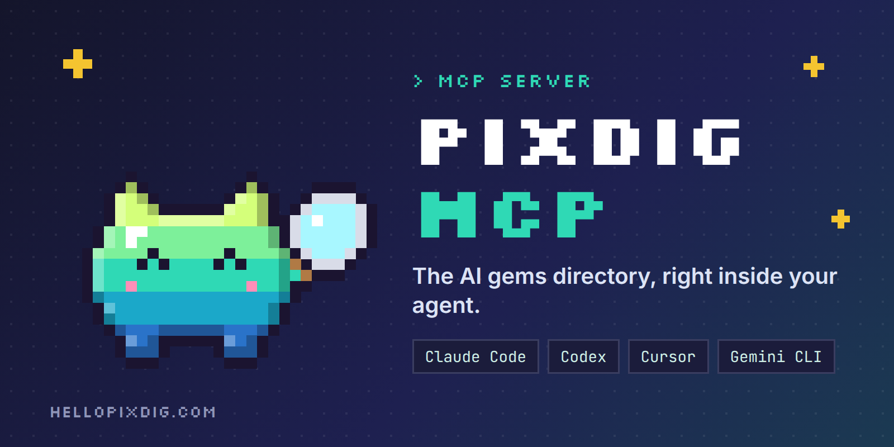
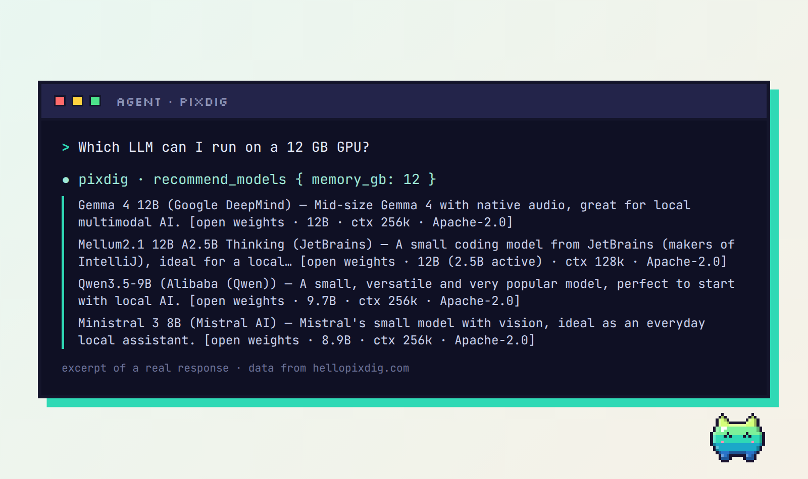
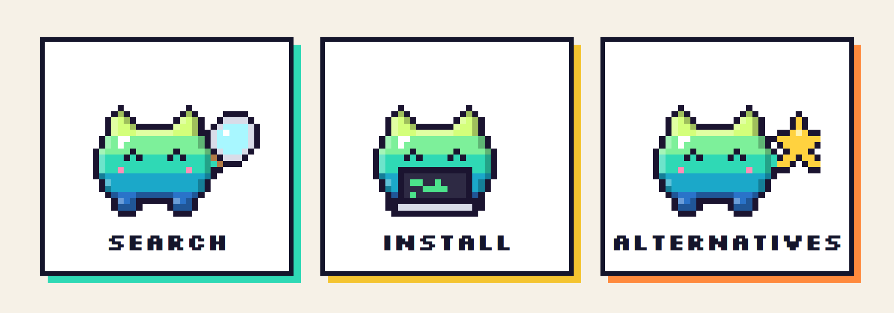
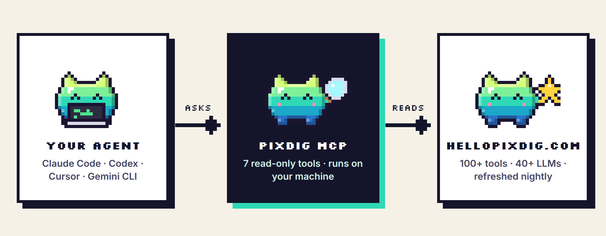

<p align="center">
  
</p>

<p align="center">
<a href="LICENSE"></a>   <a href="https://hellopixdig.com/en/"></a>
</p>

<p align="center"><b>English</b> · <a href="README.fr.md">Français</a> · <a href="README.es.md">Español</a></p>

# PixDig MCP

> The AI gems directory, right inside your agent.

**PixDig MCP** connects your coding agent to the [PixDig](https://hellopixdig.com/en/) directory: more than 100 vetted AI tools (real GitHub stars, licence, price, compatibility, the machine you need) and 40+ LLMs, with a ready-to-follow install prompt for each one. Read-only, no account, no API key.

## See it work

<p align="center"></p>
<p align="center"><sub>Excerpt of a real response from the server (data from hellopixdig.com).</sub></p>

## What you can ask your agent

- “Which free tools can edit videos locally?”
- “Find a tool for transcription that works with Ollama.”
- “Install ComfyUI for me.” → the agent fetches the page, shows you the official commands and the install prompt, and asks before running anything.
- “Which LLM can I run with 12 GB of VRAM?”
- “Find me a free alternative to ElevenLabs.”
- “Which gems are featured right now?”

<p align="center"></p>

## Install

Requires **Node.js 18+** (and `git` for the GitHub form).

**Claude Code**

```bash
claude mcp add pixdig -- npx -y github:hellopixdig/pixdig-mcp
```

**Codex (`~/.codex/config.toml`)**

```toml
[mcp_servers.pixdig]
command = "npx"
args = ["-y", "github:hellopixdig/pixdig-mcp"]
```

**Cursor (`~/.cursor/mcp.json`) · Gemini CLI (`~/.gemini/settings.json`)**

```json
{
  "mcpServers": {
    "pixdig": { "command": "npx", "args": ["-y", "github:hellopixdig/pixdig-mcp"] }
  }
}
```

No git? The same package is also served by the PixDig website (no npm account involved):

```bash
claude mcp add pixdig -- npx -y https://hellopixdig.com/pixdig-mcp.tgz
```

Prefer to check first? The whole server is one readable file, [`src/index.js`](src/index.js) (about 270 lines, two dependencies).

## How it works

<p align="center"></p>

Your agent calls the local MCP server over stdio. The server only reads public JSON files published by the PixDig website, refreshed every night.

## The 7 tools

| Tool | What it does |
|---|---|
| `search_tools` | Search by keywords, use case, compatibility (Claude Code, Ollama, MCP…), free, local, open source. Sort by stars or recency. |
| `get_tool` | Full page of a tool: what it does, recommended machine, requirements, official install commands and a ready-to-paste install prompt. |
| `list_usecases` | The directory's use cases (video, image, audio, agents, memory…) with counts. |
| `recommend_models` | LLMs by use case and type (paid / open weights). With `memory_gb`, only the open models that fit in that memory at 4-bit. |
| `get_model` | Details of a model: licence, parameters, context, access, required machine, official links. |
| `find_alternative` | Free or open-source alternatives to a paid service (ChatGPT Plus, Midjourney, ElevenLabs, Zapier, Notion, Cursor…). No argument lists every service covered. |
| `featured` | The gems currently featured. |
| `get_ranking` | Ranking of the tools by GitHub stars: last 24 hours (`day`), 7 days (`week`) or all time (`all`). |

Every tool accepts `lang: "fr" | "en" | "es"`.

## Trust and transparency

- **Read-only.** All seven tools are declared read-only. The server runs no command and writes no file.
- **One network call type.** Plain HTTPS `GET` of public JSON from `hellopixdig.com/data/api` (or a local folder, see below). The only thing sent is a `User-Agent` header, `pixdig-mcp/<version>`.
- **No telemetry, no analytics, no account, no API key.**
- **Sponsored content is labelled.** Paid placements are marked `PARTNERSHIP / SPONSORED` in answers, and the server tells the agent to say so. PixDig sells visibility, never an opinion.
- **Your agent asks first.** The server instructs the agent to show install commands and get your approval before running them.
- **Small surface.** One file, two dependencies ([`@modelcontextprotocol/sdk`](https://github.com/modelcontextprotocol/typescript-sdk) and [`zod`](https://github.com/colinhacks/zod)). Data is cached in memory for one hour.

## Configuration

| Variable | Default | Purpose |
|---|---|---|
| `PIXDIG_DATA` | `https://hellopixdig.com/data/api` | Another source: a URL, or a local folder containing `tools.fr.json`, `tools.en.json`, `tools.es.json`, `models.json`, `meta.json`, `alternatives.json`. |

## Development

```bash
git clone https://github.com/hellopixdig/pixdig-mcp.git
cd pixdig-mcp
npm install
npm test
```

`npm test` starts the server over stdio and calls every tool (it reads the live data unless `PIXDIG_DATA` is set).

## Suggest a tool

Built an AI tool? [Submit it here](https://hellopixdig.com/en/partner): free listing or paid feature, and we reply to every application. A listing is never automatic and never a guarantee.

## More

[Contributing](CONTRIBUTING.md) · [Security policy](SECURITY.md) · [Changelog](CHANGELOG.md)

---

Released under the [MIT licence](LICENSE). Made by [PixDig](https://hellopixdig.com/en/), an AI watch run from Limoges, France.
